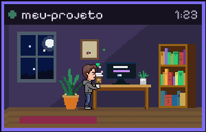
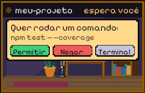
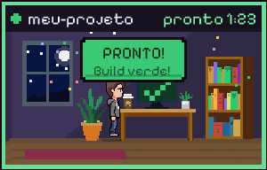

# CmdCrew

**Uma equipe de bichinhos em pixel art que trabalha junto com o seu agente de IA e avisa quando ele termina.**

Enquanto o agente pensa, edita e roda comandos, a equipe trabalha na sua tela. Quando ele termina, ela comemora e avisa. Se ele precisar de você, ela chama. Assim você pode fazer outra coisa e saber, só de bater o olho, quando é hora de voltar.

Claude Code · Codex CLI · Gemini CLI · Qwen Code · OpenCode · Copilot CLI
Windows · macOS · Linux · grátis e de código aberto (MIT) · 100% local, sem conta e sem telemetria.

[Site](https://cmdcrew.serignolli.com) · [Baixar](https://github.com/Serignolli/cmdcrew/releases/latest/download/CmdCrew-Setup.exe) · [Supporters Pack](#supporters-pack)



## Dois jeitos de ver a equipe

### Salas

Cada terminal com um agente trabalhando ganha uma **salinha no canto da tela**, logo acima da barra de tarefas, com o agente trabalhando dentro.

- Mostra o nome da pasta do projeto e um cronômetro.
- **Cada personagem tem a sua sala:** o dragão no covil, o pinguim no data center gelado, o elfo no bosque, o dev no escritório...
- **Permissões na sala:** quando o agente pede para rodar um comando ou mexer num arquivo, a sala mostra o pedido com **Permitir**, **Negar** e **Terminal**. A pergunta de sempre continua no terminal, então dá para responder onde for mais prático.
- **Duplo clique** numa sala traz o terminal dela para a frente.
- Quando termina: letreiro **PRONTO!**, confete e um som. A sala fica alguns segundos na tela (você escolhe quantos) e sai.
- Se a resposta falhar, a sala fica vermelha e toca outro som.
- Dá para mudar o tamanho, escolher o canto (direito ou esquerdo) ou arrastar a faixa para onde quiser.

| Trabalhando | Precisa de você | Pronto |
|---|---|---|
|  |  |  |

### Equipe

Os bichinhos **andam em cima da janela do terminal**: martelam, cavam, carregam coisas e falam besteira em balõezinhos. Eles seguem a janela quando você a arrasta e somem quando o agente termina. No Claude Code, o spinner do terminal ("Thinking…") também passa a usar as frases da equipe. No macOS e no Linux eles andam no rodapé (ou no topo) da tela, porque esses sistemas não deixam acompanhar a janela de outro programa sem permissões especiais.

Dá para usar um modo, o outro ou os dois ao mesmo tempo, e o personagem do terminal pode ser diferente do da sala (o dragão em cima do terminal e o dev na sala, por exemplo). Na instalação, o escolhido aparece nos dois.

## Instalar

### Windows

1. Baixe o **[CmdCrew-Setup.exe](https://github.com/Serignolli/cmdcrew/releases/latest/download/CmdCrew-Setup.exe)**.
2. Abra, escolha a equipe, onde ela aparece e os agentes, e clique em **Instalar**. Não precisa de administrador.
3. Reinicie as sessões abertas dos agentes.

Ele se instala em `%LOCALAPPDATA%\Programs\CmdCrew`, cria o atalho **CmdCrew** no menu Iniciar (a tela de configuração) e aparece em **Aplicativos instalados** do Windows, que é por onde se desinstala. Depois de instalado, abrir o `CmdCrew-Setup.exe` de novo leva direto à configuração (ele só instala de novo se for uma versão mais nova).

### macOS e Linux

```sh
curl -fsSL https://raw.githubusercontent.com/Serignolli/cmdcrew/main/install.sh | sh
```

Instala sem sudo em `~/.local/share/cmdcrew` (Linux) ou `~/Library/Application Support/CmdCrew/app` (macOS), com o comando `cmdcrew` em `~/.local/bin`, e abre o assistente no próprio terminal. Depois: `cmdcrew config` para configurar, `cmdcrew demo-salas` para ver funcionando e `cmdcrew desinstalar` para tirar tudo. Rodar o mesmo comando de novo atualiza (a configuração fica).

No Linux, as janelas precisam de X11 (ou XWayland) e de um compositor para a transparência; o duplo clique na sala volta ao terminal se o `xdotool` (ou o `wmctrl`) estiver instalado.

### Agentes

| Agente | Como a equipe fica sabendo |
|---|---|
| Claude Code | ganchos em `~/.claude/settings.json` (e as frases do spinner, se você quiser) |
| Codex CLI | ganchos em `~/.codex/hooks.json` |
| Gemini CLI | ganchos em `~/.gemini/settings.json` |
| Qwen Code | ganchos em `~/.qwen/settings.json` |
| OpenCode | um plugin em `~/.config/opencode/plugins/cmdcrew.js` |
| Copilot CLI | um arquivo de ganchos em `~/.copilot/hooks/cmdcrew.json` |

O instalador já marca os agentes que encontrar no computador; dá para ligar e desligar cada um depois. Permitir/Negar pela sala funciona no Claude Code, no Codex, no Qwen Code, no OpenCode e no Copilot CLI; no Gemini CLI a sala só avisa que ele espera você. O Cursor CLI ficou de fora por enquanto: ele ainda não dispara os ganchos de início e fim no terminal.

> O Windows pode mostrar "o Windows protegeu o computador" porque o executável não é assinado. Se preferir, compile você mesmo a partir do código (veja abaixo): é o mesmo programa.

## Personagens

Todos estes vêm de graça, cada um com várias cores:

| Categoria | Personagem | Trabalho |
|---|---|---|
| Fábrica de Chocolate | Chocolateiros | martelam e cantam (♪) |
| Fantasia | Dragão | voa em cima do terminal e cospe fogo |
| Fantasia | Elfos | atiram flechas |
| Outros | Anões mineiros | picaretam (faíscas) |
| Outros | Robozinhos, robôs clássicos | soldam, apitam, aspiram |
| Animais | Gatos, pinguins, formigas | cochilam, gelam o processador, carregam folhas |
| Claude | Clawd e as estrelinhas do Claude | digitam e soltam estrelinhas ✻ |

Cada um tem a sua sala: mina, covil do dragão, bosque dos elfos, fábrica de chocolate, sala de estar dos gatos, data center gelado dos pinguins, formigueiro, oficina dos robôs, hangar da nave e estúdio do Claude. Personagens feitos em casa trabalham numa salinha genérica.

Cada personagem é um arquivo JSON em [`personagens/`](personagens), com o desenho em texto (cada letra é uma cor da skin, `.` é transparente). Dá para criar o seu: copie um arquivo, troque o `id` e edite os desenhos. As salas ficam em [`salas/`](salas), geradas por `ferramentas/gerar_salas.py` (retângulos e algumas animações prontas).

## Supporters Pack

O CmdCrew é e continua grátis. Para quem quiser apoiar o projeto, existe o **Supporters Pack**: personagens de fantasia e RPG em alta definição, desenhados quadro a quadro, com mais animações.

- **Anões mineiros HD**: picam pedra, empurram o carrinho e carregam o saco. Também assumem a sala da mina.
- **Elfos arqueiros HD**: andam leves e acertam flechas no alvo. Trabalham no bosque.
- E mais a caminho: dragão, magos, cavaleiros...

O pack chega como um `.zip`. Para instalar, abra a configuração e clique em **Adicionar pacote…**. Os personagens do pack não fazem parte deste repositório.

## Privacidade e o que muda nos seus agentes

- Tudo roda no seu computador. Não há conta, servidor ou telemetria.
- No Claude Code, o instalador adiciona **ganchos (hooks)** ao `~/.claude/settings.json`: `UserPromptSubmit`, `Notification`, `PermissionRequest`, `PostToolUse`, `Stop`, `StopFailure` e `SessionEnd`. Se você quiser, ele também troca as frases do spinner (`spinnerVerbs` e `spinnerTipsOverride`). Nos outros agentes, os ganchos equivalentes (veja a tabela acima).
- Antes da primeira alteração em cada arquivo ele faz um backup: `<arquivo>.antes-cmdcrew.bak`. Os ganchos de outros programas ficam como estão.
- O gancho de permissão só decide algo quando você clica em **Permitir** ou **Negar** na sala. Sem clique, ou com **Terminal**, o agente segue com a pergunta normal. Isso pode ser desligado na configuração.
- A sala acompanha tarefas longas até o fim (builds, testes, subagentes, raciocínios demorados). Ela sai quando o agente termina, quando você interrompe com Esc (a interrupção aparece na conversa) ou, como rede de segurança, depois de 30 minutos sem nenhuma atividade.
- Desinstalar tira todos os ganchos e devolve as frases originais.

## Para quem desenvolve

No Windows não precisa instalar nada: o executável é compilado com o compilador C# que já vem no Windows (.NET Framework 4). A versão de macOS e Linux fica em `go/` (Go + [Ebitengine](https://ebitengine.org)) e lê os mesmos `personagens/`, `salas/` e `config.json`.

| Arquivo | O que faz |
|---|---|
| `scripts\instalar.cmd` | compila e liga os ganchos usando esta pasta (eles apontam para `bin\CmdCrew.exe`) |
| `scripts\configurar.cmd` | abre a configuração |
| `scripts\testar.cmd` | mostra três salas de demonstração (uma pede permissão, outra falha) |
| `scripts\desinstalar.cmd` | tira os ganchos do Claude Code |
| `src\build.ps1` | só compila: `bin\CmdCrew.exe` e `dist\CmdCrew-Setup.exe` |
| `sh go/empacotar.sh` | compila a versão de macOS e Linux: `dist/cmdcrew-<sistema>-<arq>.tar.gz` (não precisa de cgo, sai de qualquer sistema) |

Nesse modo, o caminho do executável fica gravado nos ganchos. Se mover a pasta, rode `scripts\instalar.cmd` de novo.

### Estrutura

```
src/              código C# (WinForms), o programa do Windows
  Program.cs        comandos e ganchos (start, wait, permission, tool, stop, fail, end)
  Agents.cs         os agentes (Claude Code, Codex, Gemini CLI, Qwen Code, OpenCode, Copilot CLI)
  Sessions.cs       estado de cada sessão (%LOCALAPPDATA%\CmdCrew\sessoes)
  Strip.cs          a faixa de salas no canto da tela, sons e cliques
  Rooms.cs          lê as salas (salas/*.json) e anima o personagem dentro
  Overlay.cs        a equipe em cima do terminal
  ConfigForm.cs     a tela de configuração
  SetupForm.cs      o assistente de instalação (Installer.cs copia e registra)
  recursos/         fonte Pixelify Sans, ícone e sons
go/               o programa de macOS e Linux (mesma lógica, em Go)
personagens/      personagens gratuitos (JSON), embutidos no instalador
salas/            uma sala por personagem (JSON gerado por ferramentas/gerar_salas.py)
agentes/          o plugin do OpenCode
install.sh        instalador de macOS e Linux
site/             o site (HTML/CSS/JS estático, publicado na Vercel)
ferramentas/      scripts Python: gerar o site, os GIFs e os personagens
scripts/          atalhos para quem clona o repositório: instalar, configurar, testar, desinstalar
```

### Comandos úteis

```
bin\CmdCrew.exe demo-salas 3 10        salas de demonstração
bin\CmdCrew.exe demo 12                equipe de demonstração em cima da janela ativa
bin\CmdCrew.exe shot dragao pronto x.png  sala de um personagem (ou id da sala) num PNG
python ferramentas/gerar_salas.py      refaz salas/*.json
bin\CmdCrew.exe sheet folha.png        todos os personagens, skins e quadros numa folha
python ferramentas/gerar_site.py       atualiza site/dados.js com os personagens gratuitos
python ferramentas/gerar_gifs.py       atualiza os GIFs do site (precisa do supporters-pack/)
```

### Publicar uma versão

Crie uma tag `v*` (por exemplo `git tag v1.1.0 && git push --tags`). O workflow `release.yml` compila e publica na release o `CmdCrew-Setup.exe` (Windows) e os pacotes `cmdcrew-*.tar.gz` (macOS e Linux, usados pelo `install.sh`). O site sempre aponta para `releases/latest`.

## Créditos

- Sons feitos no [SFX Forge](https://github.com/Serignolli/sfx-forge).
- Fonte [Pixelify Sans](https://fonts.google.com/specimen/Pixelify+Sans) (SIL Open Font License).

Desenvolvido por [Serignolli](https://serignolli.com). Licença [MIT](LICENSE).
